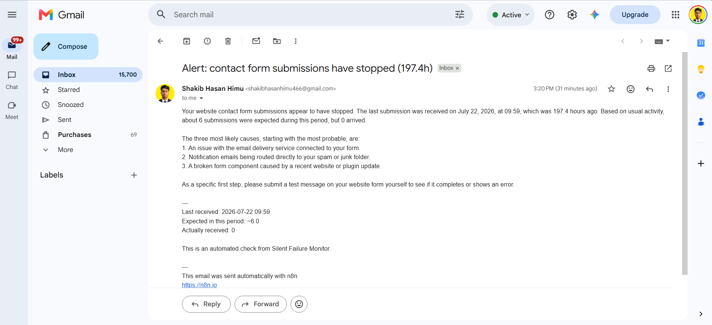
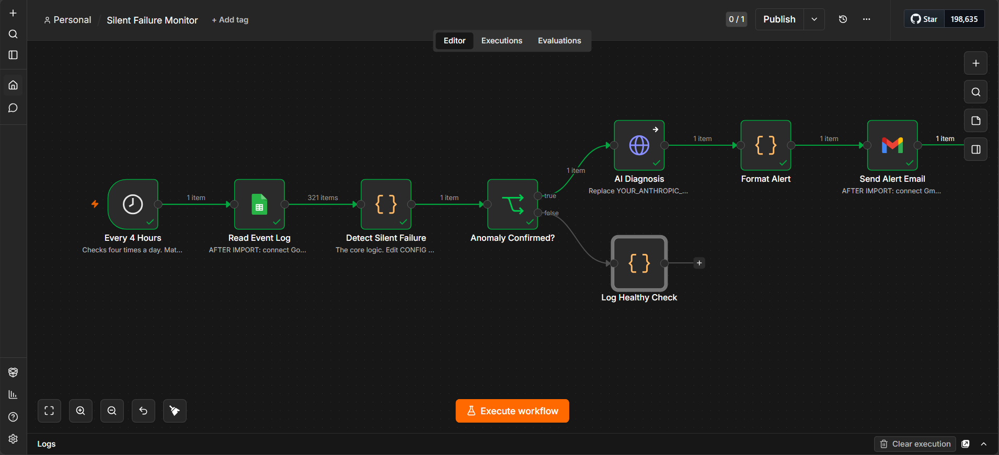

# Silent Failure Monitor

**Most monitoring watches for things going wrong. This watches for things that stop happening.**

When a checkout breaks, revenue drops and you notice. When a login breaks, users complain within
minutes. But when a contact form breaks, nothing happens — no error, no complaint, no alert. Leads
just quietly stop arriving, and the business owner assumes marketing is having a slow month.

The failure mode is **absence, not error** — and absence is invisible to conventional monitoring.

---

## What it actually produces

A real alert generated by the workflow in this repo:

> **Subject: Alert: contact form submissions have stopped (197.4h)**
>
> Your website contact form submissions appear to have stopped. The last submission was received on
> July 22, 2026, at 09:59, which was 197.4 hours ago. Based on usual activity, about 6 submissions
> were expected during this period, but 0 arrived.
>
> The three most likely causes, starting with the most probable, are:
> 1. An issue with the email delivery service connected to your form.
> 2. Notification emails being routed directly to your spam or junk folder.
> 3. A broken form component caused by a recent website or plugin update.
>
> As a specific first step, please submit a test message on your website form yourself to see if it
> completes or shows an error.

Detecting the outage is half the value. Explaining it in language a non-technical owner can act on
is the other half.



---

## The problem, with numbers

Broken lead forms are routinely discovered weeks or months after they break. For a local contractor
with a $3,000 average job value, missing five inquiries a month is **$15,000 a year in revenue that
never announces itself**.

The failure points are mundane and invisible:

- a plugin or theme update quietly breaks the form
- notification emails start going to an ex-employee's address
- a spam filter begins swallowing legitimate submissions
- SPF/DKIM/DMARC tightening causes the site to stop sending mail entirely
- the CRM webhook silently stops firing

The site still loads. The form still appears to submit. Nothing is "down".

## Why existing tools miss it

Most tools in this space use **synthetic testing** — submit a fake entry, check whether it arrives.
That works, but it carries three structural costs:

| Synthetic testing | This approach |
|---|---|
| Needs site access + per-form setup | Needs read access to where results land — nothing else |
| Creates fake leads in the client's CRM | Zero test data; reads real history only |
| Only tests what you configured | Any event stream: forms, orders, bookings, reports |

The alternative is simpler: **stop testing the form, start watching the inbox.** If the events
aren't arriving, something upstream is broken — you don't need to know which part failed to know
that it failed.

---

## How it works

```
Event source (Sheet / inbox / CRM export)
            |
            v
   Build a rhythm baseline          "Thursdays 12-4pm normally bring ~3 submissions"
            |
            v
   Compare the recent window        "This Thursday 12-4pm brought 0"
            |
            v
   Confirm across 2 windows         (kills one-off noise)
            |
            v
   AI writes a plain-English alert  -> email / Slack
```

The baseline is keyed on **(weekday, 4-hour block)** and uses the **median**, because businesses
have weekly rhythms — a Tuesday 10am is not a Sunday 10am — and a median ignores one freak busy day
that would drag an average upward.

---

## What's in this repo

| Path | What it is |
|---|---|
| `engine/monitor.py` | The detection engine. Runs standalone, no dependencies. |
| `engine/sample_data/` | Nine weeks of realistic data — one healthy stream, one that stops. |
| `n8n/silent-failure-monitor.json` | Importable n8n workflow (scheduled → detect → AI → email). |
| `make/blueprint.json` + `make/BUILD_GUIDE.md` | The same system built in Make.com. |
| `docs/HOW_IT_WORKS.md` | Detection logic and design decisions in detail. |
| `screenshots/` | The running workflow and a real generated alert. |

### Try it in 30 seconds

```bash
git clone https://github.com/himu98/silent-failure-monitor.git
cd silent-failure-monitor/engine

# a stream that has quietly stopped
python3 monitor.py sample_data/form_submissions_broken.csv --now "2026-07-28 16:00"

# a healthy stream - should stay quiet
python3 monitor.py sample_data/form_submissions_healthy.csv --now "2026-07-28 16:00"
```

No API key needed — a rule-based fallback generates the diagnosis so the tool always runs. Set
`ANTHROPIC_API_KEY`, or point the n8n HTTP node at Gemini, for AI-written alerts.

---

## Build log: two silent failures inside a silent-failure detector

Both bugs below produced a **green, successful-looking run with a confidently wrong answer**.
Neither threw an error. They were caught by comparing output against expected values, not by
watching for red nodes — which is the entire discipline this project is about.

### Bug 1 — Google Sheets silently ate a quarter of the data

The n8n Code node parsed timestamps with `new Date(raw.replace(' ', 'T'))`. That works on the raw
CSV, where times are zero-padded (`09:59:00`).

But Google Sheets **strips the leading zero on import** — `09:59:00` becomes `9:59:00`. The string
`"2026-07-27T9:59:00"` is not valid ISO 8601 (hours must be two digits), so JavaScript returned
`Invalid Date` and the code silently skipped those rows.

Every 9am event was being discarded. The monitor reported a last-event date five days earlier than
reality, and nothing anywhere indicated data loss.

**Fix:** a tolerant parser accepting single-digit hours and months, `YYYY-MM-DD` and `M/D/YYYY`
layouts — plus **a counter that logs a warning when rows can't be parsed**. Silent data loss inside
a tool built to detect silent failures was too fitting to leave in.

### Bug 2 — a timezone shift in the display layer

The alert showed `lastEvent: 2026-07-22 03:59` when the data said `09:59` — exactly six hours off,
matching the local UTC offset. The detection maths was correct (all comparisons happen in local
time); only the output line was wrong, because it used `.toISOString()`, which converts to UTC
before formatting.

**Fix:** format with local date getters instead of `toISOString()`.

A monitoring tool that reports the wrong time is arguably worse than one that reports nothing —
someone will correlate that timestamp against a deploy log and reach the wrong conclusion.

---

## Design decisions worth explaining

**False alarms destroy monitoring tools.** An alerting system nobody trusts gets muted, and a muted
monitor is worse than none — so most of the engineering here is noise suppression:

- **Two consecutive windows must both look wrong** before anything is sent. One quiet afternoon is
  not an outage.
- **Business hours and business days are respected.** No 3am alerts for a 9–5 business.
- **Normally-quiet windows are skipped.** If a slot averages under 1.5 events, its silence means
  nothing.
- **Zero-event windows count toward the baseline.** Skipping them biases the median upward and makes
  the monitor under-react — caught during testing.
- **The baseline excludes the last 24 hours**, so an in-progress failure can't quietly redefine
  "normal" as zero.
- **A 12-hour cooldown** stops the same outage alerting every four hours.
- **Minimum 14 days of history** before the tool will judge anything at all.

**Failures are handled gracefully.** The n8n workflow continues even if the AI node fails, and the
alert formatter falls back to a rule-based diagnosis, handling both Anthropic and Gemini response
shapes. During this build the AI provider rate-limited a request mid-test and the alert still went
out correctly. A monitoring tool that goes silent when a dependency breaks has recreated the exact
problem it exists to solve.

---

## Known limitations

- **Public holidays look like outages.** A holiday calendar is the obvious next feature.
- **Seasonal businesses** with long quiet periods need a longer baseline than 90 days.
- **Very low-volume businesses** (under ~1 event/day) have no rhythm to detect a break in —
  synthetic testing is the right tool for them.
- **Partial failures** (a form broken only in one browser) show as a dip, not a stop, and may sit
  above the sensitivity threshold. Severity tiers would address this.

## Where this goes next

- Read directly from Gmail/IMAP so no spreadsheet is needed
- Auto-refresh the baseline weekly instead of monthly
- Holiday calendar awareness
- Multi-stream dashboard for agencies watching many clients
- Severity tiers: a 60% drop is a warning, a 100% stop is an alert

---

## Why I built it

I spent a year as an IT monitoring specialist watching production systems. The daily work was
noticing when a pattern broke before anyone filed a ticket, then explaining the finding to people
who didn't speak the technical language.

This project is that instinct, pointed at small businesses that will never buy Datadog. The
monitoring discipline is the same; only the audience changed.

---

## License

MIT — use it, sell it, break it, improve it.
